<picture>
  <source media="(prefers-color-scheme: dark)" srcset="https://raw.githubusercontent.com/manifoldbt/.github/HEAD/profile/assets/hero-dark.svg">
  
</picture>

[Website](https://www.manifoldbt.com) · [Docs](https://www.manifoldbt.com/documentation) · [Quick start](https://github.com/manifoldbt/manifoldbt#quick-start) · [Benchmarks](https://www.manifoldbt.com/benchmarks) · [Examples](https://github.com/manifoldbt/manifoldbt/tree/master/examples) · [Pricing](https://www.manifoldbt.com/#pricing) · [Discord](https://discord.gg/bvU6Wjc72d)

Python backtesting with a Rust engine. You describe a strategy once in a Python DSL; signals, fills, fees, funding and equity then all run in Rust, fast enough to sweep whole grids and strict enough that every fill rule is written down and tested.

## Pick your route

| You want to | Go to | Start with |
| --- | --- | --- |
| Run a backtest | [manifoldbt](https://github.com/manifoldbt/manifoldbt) | `pip install manifoldbt` |
| Have an agent write the strategy | [MCP docs](https://www.manifoldbt.com/mcp) | Connect `https://mcp.manifoldbt.com/docs/mcp`, no key and nothing to install |
| Run the research method with an agent | [quant-research-skill](https://github.com/Jimmy7892/quant-research-skill) | `claude plugin marketplace add Jimmy7892/quant-research-skill` |
| Read working strategies first | [examples](https://github.com/manifoldbt/manifoldbt/tree/master/examples) | `python examples/13_stochastic_simulation.py` |
| Walk through it in the browser | [notebook](https://www.manifoldbt.com/notebook) | Strategy, sweep, walk-forward, Monte Carlo |
| Check our numbers | [benchmarks](https://github.com/manifoldbt/manifoldbt/actions/workflows/bench-vs-vectorbt.yml) | Fork the repo and press **Run workflow** |

Community is free, with no account, no key and no compiler. Wheels for Linux, Windows and macOS on Apple Silicon.

## From bars to the order queue

| Your data | What decides a fill | See it run |
| --- | --- | --- |
| Bars | OHLC, with the unfavourable path assumed: the stop beats the target, a gap fills at the open | [26_fill_costs.py](https://github.com/manifoldbt/manifoldbt/blob/master/examples/26_fill_costs.py) |
| Options | Contracts that expire and settle at intrinsic value | [23_deribit_options.py](https://github.com/manifoldbt/manifoldbt/blob/master/examples/23_deribit_options.py) |
| Trades inside each bar | The prints themselves, in the order they happened | [27_bars_vs_tape.py](https://github.com/manifoldbt/manifoldbt/blob/master/examples/27_bars_vs_tape.py) |
| Trade clock | A queue and a latency, one simulation row per print | [28_trade_clock_market_maker.py](https://github.com/manifoldbt/manifoldbt/blob/master/examples/28_trade_clock_market_maker.py) |
| L2 order book | Your estimated place in each price level's queue | [31_dsl_market_maker.py](https://github.com/manifoldbt/manifoldbt/blob/master/examples/31_dsl_market_maker.py) |
| Market by order | Your exact place in the queue, order by order | [32_mbo_queue_maker.py](https://github.com/manifoldbt/manifoldbt/blob/master/examples/32_mbo_queue_maker.py) |

Connectors for Binance, Bybit, Hyperliquid, dYdX, Bitstamp, Deribit, Yahoo Finance, London Strategic Edge, Databento and Massive, or bring your own CSV. Trades and order books are part of [Researcher](https://www.manifoldbt.com/researcher).

## Check it yourself

A backtest is a claim. Each of these runs on your machine, against the wheel you installed.

- **Fill rules.** [Written out](https://github.com/manifoldbt/manifoldbt#execution-semantics) and pinned by tests, the pessimistic one wherever a choice existed.
- **Parity.** [Entry price, exit price and exit reason](https://github.com/manifoldbt/manifoldbt/blob/master/python/tests/test_parity_vectorbt.py) asserted against vectorbt, on the wheel published to PyPI.
- **Look-ahead.** [Corrupt every bar after a cut point](https://github.com/manifoldbt/manifoldbt/blob/master/examples/25_lookahead_trap.py) and require the equity before it to come back bit-identical.
- **Replay.** Every result carries a manifest; `mbt.replay(manifest, strategy, store)` regenerates the run.
- **This page.** The surface above is [a real sweep](https://github.com/manifoldbt/.github/blob/HEAD/tools/hero_surface.py), and it runs on a fresh install.

A reproduction showing a fill the engine gets wrong is the most useful [report](https://github.com/manifoldbt/manifoldbt/issues) this project can receive. Agents can read [llms.txt](https://www.manifoldbt.com/llms.txt). Research software, not financial advice.
